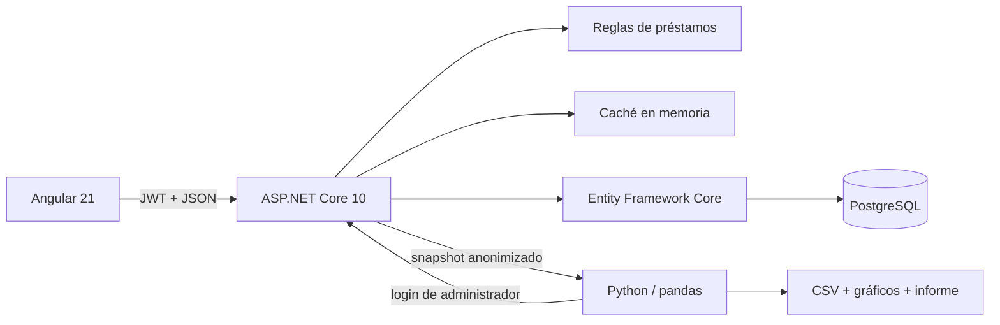

# Arquitectura y defensa técnica

## Flujo principal

La separación en Domain, Application, Infrastructure y Api mantiene las reglas independientes de HTTP y PostgreSQL. El alcance no necesita microservicios, broker, CQRS ni repositorios genéricos. `LoanStore` existe porque concentra consultas, transacción, concurrencia y caché; una abstracción adicional no aportaría valor.

## Modelo

- `User`: identidad, correo único, hash de contraseña, rol, estado y versión de seguridad.
- `Loan`: propietario, monto decimal, plazo, estado, fechas y token de concurrencia.
- `LoanDecision`: administrador, decisión, motivo y fecha. La relación única garantiza una sola decisión.

Las transiciones válidas son `Pending → Approved` y `Pending → Rejected`. Una solicitud decidida no puede editarse ni eliminarse. La concurrencia optimista evita que dos administradores confirmen decisiones distintas.

## Seguridad

El JWT dura 30 minutos y contiene rol y una versión de seguridad. Cada petición comprueba que el usuario siga activo y que la versión coincida. La API filtra préstamos por propietario, aunque la interfaz oculte rutas. Las contraseñas usan `PasswordHasher` y las consultas de EF Core son parametrizadas. CORS permite solo el origen local de Angular.

Para una demostración, Angular conserva la sesión en `sessionStorage`. En banca real usaría un backend for frontend y cookie `HttpOnly`, MFA, rotación de claves, auditoría centralizada y un proveedor de identidad.

## Datos y analítica

El endpoint `/api/analytics/loans` exige rol administrador y excluye PII. La extracción usa una transacción `REPEATABLE READ`, versión de esquema, moneda y hora de corte. Python detiene el informe cuando falla una regla de calidad. Los artefactos son reproducibles desde el JSON guardado.

## Trade-offs

La caché es local a cada instancia; funciona en esta aplicación simple. Con varias réplicas usaría una caché distribuida o invalidación por eventos. El seed facilita la evaluación y se desactiva por configuración. Los datos demo no constituyen un modelo de riesgo. La API y el frontend son servicios separados para mostrar el contrato, aunque una entrega pequeña también podría servir los archivos estáticos desde ASP.NET Core.
